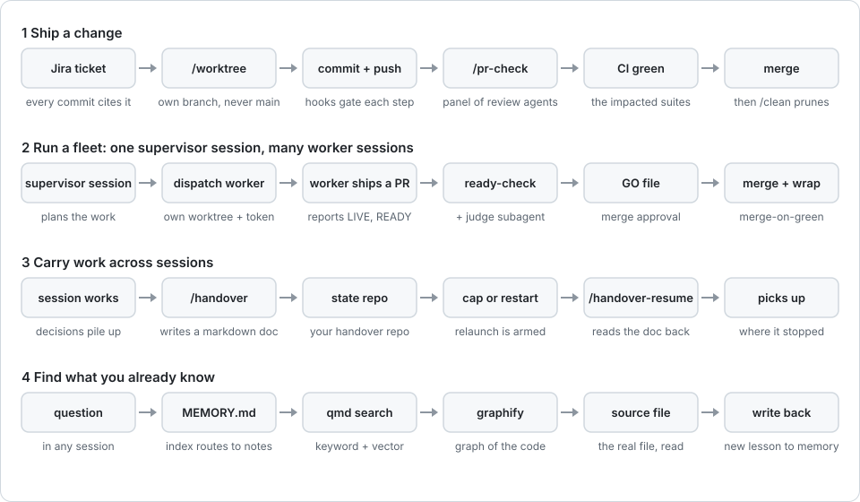

# himmel

> **A control plane for coding agents.**

himmel turns Claude Code into a team you can leave running. The install adds
checks and handover notes to your sessions; the team is a further step you set
up. In that setup one session, the *chief*, coordinates the work and oversees
it. To plan a big change, the chief starts a subagent or a new session that
runs [minerva](marketplace/plugins/himmel-ops/skills/minerva/SKILL.md). The
chief then hands each ticket to a *worker* session of its own, checks every
result, and approves each merge.
Work can carry on while you are away and restart after a usage limit. A new
session reads the note the last one left, and a local UI shows you what all of
them are doing.

Still deciding? [Take a short test run](#still-deciding-take-a-short-test-run)
on a spare project: one command puts himmel on, one takes it off. Ready to use
it on your own project, or here to work on himmel itself? Go to the
[Quickstart](#quickstart).

## Why use himmel

Most of what himmel offers comes from running it whole: parallel sessions run
by a chief, runs that carry on overnight, a second brain that fills itself.
You can install less, and each step is optional. Without the fleet and the
vault, what remains is mainly guards and configuration, and the UI and the
evals have little to show. The [adoption trail](docs/adoption-trail.html) lays
the steps out as levels, and each level says what it gives you, what it costs
and how to turn it off.

Along with that you get:

- **A simple install.** One command. It shows what it will add before it
  adds anything, then asks a few questions, each with a default answer
  ([install profiles](docs/setup/profiles/README.md)). One command takes it
  off again.
- **A UI that shows the fleet.** `himmelctl ui` opens a local page. The part
  that stands out is the AG-UI Fleet page: it lists every live session with its
  ticket, PR and state, and opens the run of any one of them. The other pages
  show what is installed and whether it is healthy, and turn features on and
  off, with a preview before each change ([the himmel UI](docs/ui.md)).
- **Evals, not promises.** himmel measures itself: how often the review
  panel catches planted bugs, how often its findings are right and what the
  prompt cache saves, each number with its sample size
  ([evals](docs/evals/README.md)).
- **Sessions that remember.** Work carries from one session to the next in
  plain notes, so you stop explaining the same thing twice.

### How the work moves

One ticket travels the same path every time:

1. **Plan.** For a big or core change, a subagent or a new session runs minerva
   first: questions, a spec, a plan, each one checked by a critic before the
   next step.
2. **Build.** The chief hands the ticket to a worker. The worker gets its own
   branch and working folder. Before it starts a group of workers, the chief
   checks that no two of them plan to change the same files; an overlap with an
   open PR can pass if it is small and merges clean
   ([parallel waves](docs/handover/running-a-chief.md#parallel-waves)).
3. **Review.** The worker runs `/pr-check`: a second model reads the change,
   if you have one set up, and the worker checks each finding against the
   code, then fixes it, rules it out or moves it to a ticket of its own. With
   no second model, the worker reviews the change itself, so nobody independent
   reads it. In a himmel checkout a push marks the review as owed, and the PR
   cannot be opened until `/pr-check` clears it. In an adopted project nothing
   forces the review at this point.
4. **Approve.** The chief checks the result and approves the merge of that
   one PR at the exact commit that was reviewed. It can ask an independent
   judge for a second opinion first.
5. **Merge.** Only then does the worker merge, close the ticket and leave a
   note for the next session. Merging has its own gate, which refuses while CI
   is red or pending or a reviewer finding is open.

### How sessions find what is already known

Before a session improvises, it can look things up. Each of these tools points
at real files, not at facts copied out of them:

- **A short memory index.** Claude Code's `MEMORY.md` stays a list of one
  line per topic, each pointing to a note, so it stays small enough to load
  every time.
- **Search over your notes.** qmd, a local search engine, finds a handover,
  a doc or a vault note by its words or its meaning.
- **A map of the code.** graphify answers questions about how the code fits
  together: what calls what, and which files belong together.

[Second brain and memory](#second-brain-and-memory) has the detail.

## Still deciding? Take a short test run

Try himmel on a spare project before you put it on a real one. The test run
shows the guards, the handover notes and the setup pages of the UI, not the
fleet or the vault.
[Getting Started](docs/getting-started.md) walks through it step by step:
each step says which folder to run it from and what you should see.

You need git, node with npm, jq, python3 and Claude Code, signed in. The
installer checks for them and stops with install hints if one is missing.

1. **Install it.** Make the spare project, download himmel, preview the
   install, then run it:

   ```bash
   mkdir ~/try-himmel && cd ~/try-himmel && git init -b main
   git commit --allow-empty -m "chore: initial commit #1"
   git clone https://github.com/yotamleo-org/Himmel ~/himmel   # once
   node ~/himmel/scripts/himmelctl/bin.js install --scope project --dry-run
   node ~/himmel/scripts/himmelctl/bin.js install --scope project
   ```

   It adds hooks and settings for Claude Code (under `.claude/`), the scripts
   they run (`scripts/`) and `.gitignore` entries. Commit the result before the
   next step, because a worktree is cut from committed history
   ([why these commands](docs/setup/install.md#persist-commit-it-before-you-branch)):

   ```bash
   git switch -c chore/install-himmel
   git add -A
   git commit -m "chore: install himmel #1"
   git switch main
   git merge --ff-only chore/install-himmel
   ```

2. **Pick up where you stopped.** Start a change in its own worktree with
   `bash scripts/worktree.sh feat/try-himmel`, go into the folder it prints and
   start `claude` there. Run `/handover-setup` once to choose where session
   notes live, then end the session with `/handover`. Open a fresh session, ask
   it to resume, and it reads the note and carries on from the decisions and
   reasons the note recorded.
3. **Open the UI.** `node ~/himmel/scripts/himmelctl/bin.js ui` (needs
   `bun`) shows what the install set up and what you can turn on next.
4. **Take it off.** From the project,
   `node ~/himmel/scripts/himmelctl/bin.js uninstall --dry-run` lists what
   would go; the same command without `--dry-run` removes it (add `--yes` when
   there is no terminal to confirm in).

Along the way the guardrails do their part: an edit on `main` is refused
before the file changes, not only when you push.

> Deciding whether it is worth it? Read [**Why himmel**](docs/why-himmel.md),
> the failure modes it exists for and what each one costs. Want the design
> in one read? [**System design**](docs/system-design.md) explains the parts,
> one ticket's flow, the trust model and the trade-offs. Want the wiring?
> [**Architecture**](docs/architecture.md) shows how the guardrails, the
> handover notes, the parallel sessions, the Jira link and the logs fit
> together.

## What himmel is

If you work with a coding agent every day, alone or in a small team, himmel
is for you. Claude Code still runs your sessions; himmel installs on top of it
and adds checks before edits, commits, pushes and merges, so nobody has
to remember those rules. Each change gets its own branch and pull request (PR), each commit names
its ticket (a Jira issue, or a plain `#number` if you do not use Jira), and
notes carry the work into the next session. Run several sessions at once and
they work like a small software factory: tickets go in, reviewed and merged
PRs come out, and each merge still waits for the chief's approval, signed
for that one PR at the exact commit that was reviewed.

Built for Claude Code. The guardrails also run under Codex CLI, through its
hooks and an `AGENTS.md` file. Other agents are not supported yet;
[harness compatibility](docs/internals/harness-compat.md) has the detail.

It has four layers, and each one works without the layers above it:

1. **The guarded session.** Checks run before Claude Code edits a file and
   before a commit, a push or a merge, and refuse what breaks the rules.
2. **Handover and memory.** Plain markdown notes carry the work and its
   reasons from one session to the next, with a search index to find them.
3. **The chief and its workers.** One session, the *chief*, coordinates the
   work and hands each ticket to a *worker*, another session that owns that
   one change. The chief checks each result and approves its merge; the
   worker then merges. [The command layer](docs/jarvis-subsystems.md)
   describes it.
4. **The surface.** The himmel UI (`himmelctl ui`), Telegram, the
   statusline, the morning report and the metrics show you what the sessions
   are doing and let you steer the chief.

The idea is simple: anything you would otherwise repeat by hand (checking a
commit, reviewing a PR, writing down where you stopped, restarting after a
usage limit) becomes a tool or a gate. Safety comes from structure, not from
Claude remembering a paragraph of instructions.

## What you get

The test run shows a few of these. The rest arrive as you add them, and the
[adoption trail](docs/adoption-trail.html) says which level brings each one.

**Run the work**

- **Many sessions, one chief.** A chief session coordinates the work, hands
  each ticket to a worker with its own branch and PR, and checks each result
  before it merges ([the command layer](docs/jarvis-subsystems.md)).
- **Work can run while you are away.** `/afk-shift` (afk: away from keyboard)
  pulls tickets from your Jira queue and shows you a plan; nothing starts until
  you confirm. Each ticket gets an agent that branches, reviews its own change
  and opens a PR. By default the shift stops at a green, reviewed PR and leaves
  the merge to you, and `/stop` halts it
  ([AFK runs](docs/handover/afk-mode.md)).
  On a machine set up for it, when a session nears its usage limit a hook
  schedules a relaunch with the operating system's scheduler and has the
  session write a handover first. A project install alone does not add that
  hook, and without a working scheduler the relaunch never fires, so nothing
  restarts the run
  ([scheduler setup](docs/setup/new-machine.md#4c-scheduler-backend-auto-arm-resume)).
- **Work carries over between sessions.** `/handover` leaves a plain markdown
  doc behind. A fresh session reads it and resumes from the decisions and
  reasons it recorded.

**Keep it right**

- **Review before merge.** `/pr-check` has a second model read the change, if
  you have one set up, and the session rules on each finding against the code,
  so a finding that misreads the code is disproved, not fixed. The merge gate
  refuses while CI is red or pending or a reviewer finding is open. Review is
  not proof: the required reviewer caught 9 of 12 planted bugs, and the PR's
  author ruled 79.5% of its 5,388 ruled findings right
  ([evals](docs/evals/README.md)).
- **Rules that hold.** Hooks stop edits on `main` and reads of secret files, and
  in a himmel checkout opening a PR while a review is owed, at the moment Claude
  tries the tool call, so a rule holds even after it falls out of the context
  window.

**Remember and find**

- **A second brain, not just a memory file.** With the optional notes vault, a
  hook leaves a note when a session ends normally, search finds a note by its words or its
  meaning, and a graph shows which notes connect. It is all plain markdown
  you can open and fix. [Second brain and memory](#second-brain-and-memory)
  says what sets it apart.

**Token use, measured**

These numbers count tokens and bytes, not money: what you pay depends on your
models, your plan and how much work you run, and no dollar comparison has been
measured.

- **Sessions start lean.** What every Claude Code session loads up front
  (`CLAUDE.md` plus the skill and command listings) was cut in half, from
  43,916 to 21,867 bytes ([measured](docs/token-economy.md#claudemd-lean-invoke-measured-2026-08-23)),
  and a pre-commit gate now keeps `CLAUDE.md` under 6 KiB. The detail lives
  in pages a session opens only when it needs them.
- **Workers start thin.** A worker starts from a thin
  profile with only the plugins and the one search server it calls
  ([session profiles](docs/internals/lane-calibration.md)).
  [lean-skills](marketplace/plugins/lean-skills/README.md) carries the 14
  skills himmel calls in place of 26 from two larger plugins. Those two and a
  third always-on plugin carried about 2.2k tokens of skill listings into every
  session; the net saving has not been measured.
- **The prompt cache.** Session openings stay stable, so the cache can reuse
  them: 98.4% of input tokens were cache reads in the 425 sessions of this
  project that were measured ([evals](docs/evals/README.md)).
- **Retrieval is measured next.** An eval prices how many tokens each way of
  looking things up spends to reach a correct answer
  ([answer-ab](scripts/eval/README.md#tokens-to-a-correct-answer-answer-ab)).
  Its full run is still pending, so no saving is claimed here yet.
- **Smaller tools, shorter output.** A local Jira CLI stands in for a Jira MCP
  (Model Context Protocol) server, and a command-line filter shortens noisy
  output before Claude reads it.

**Fit your setup**

- **GitHub or Bitbucket.** The worktree, PR and merge loop works the same on
  GitHub and Bitbucket Cloud. himmel picks the backend from each repo's
  `origin` remote.
- **Linux and macOS.** Linux is checked on every PR, macOS on a scheduled
  run. Details in the [Support matrix](#support-matrix).

## How it flows

<p align="center">
  
</p>

<!-- The diagram is rendered by scripts/docs/render-flows.py: edit the script, not the image. -->

The diagram shows the four flows that make up most of a day with himmel.

**1. Ship a change.** Give your change its own branch and working folder with
`scripts/worktree.sh`, so you never edit `main` directly. Each commit names its ticket.
Checks on each commit and push examine the message format, secrets and
statements of what was tested. `/pr-check` runs a review; once the pull
request (PR) is approved, continuous integration (CI) tests for the affected
suites pass and, in a fleet run, the chief has approved the merge in writing
for its exact commit, the PR can merge. `scripts/clean.sh` removes the finished
worktree.

**2. Run a fleet: one chief, many workers.** For bigger runs, one Claude
session acts as the *chief*. It coordinates the work and starts *workers*, other
Claude sessions that each own one ticket, one worktree and one PR. Each
worker reports back and never merges on its own. The chief checks the PR (and
can ask an independent judge for a second opinion) and approves the merge in
writing; only then does the worker merge. The [glossary](docs/glossary.md)
defines chief, worker, judge and the rest.

**3. Carry work across sessions.** A session that has made decisions writes
them into a handover doc with `/handover`. The doc lives where you chose with
`/handover-setup`: a folder in your vault, a separate git repo, or a
`handovers/` folder in the project. When a session nears its usage
limit, himmel schedules a restart. The next session runs `/handover-resume`,
reads the doc, and continues where the last one stopped.

**4. Find what you already know.** Before improvising, a session looks up
what is already known. Claude Code's per-project `MEMORY.md` is a short index
that routes a keyword to a topic note. `qmd`, a local search engine, searches
the markdown itself (notes, handovers, docs) by keyword and meaning.
`graphify`, a map of the code, answers questions about how the code fits
together. These tools point at real files, and a lesson learned on the way
can be written back to memory for the next session.

The commands behind flow 1, numbered in the order you run them. In your shell,
from the project:

```bash
bash scripts/worktree.sh feat/my-thing   # 1. its own branch and worktree (never edit on main); cd into it
git add <files>                          # 2. after working with Claude in the worktree
git commit && git push                   # 2. hooks check the message, secrets and statements of what was tested
gh pr create                             # 4. then merge once CI is green and the PR is approved
bash scripts/clean.sh                    # 5. after the merge: prune merged worktrees
```

In Claude Code:

```text
/himmel-ops:pr-check      # 3. review; `/pr-check` inside a himmel checkout
/handover                 # 6. write down where you stopped
```

A himmel checkout also has `/worktree` and `/clean` for steps 1 and 5.

Going unattended, in Claude Code:

```text
/afk-shift --limit 5   # five tickets to parallel agents, each ending in a PR
/stop                  # ask an overnight run to halt gracefully
```

[`docs/daily-loop.md`](docs/daily-loop.md) walks flow 1 end to end and
explains every hook at the moment it fires.
[`docs/configuration.md`](docs/configuration.md) lists every gate, knob and
off switch in one place. Pointing an AI assistant at this repo? Give it
[`llms.txt`](llms.txt), a map of the repo written for language models.

## Quickstart

himmel runs on top of [Claude Code](https://claude.com/claude-code), so
install Claude Code first:
`curl -fsSL https://claude.ai/install.sh | bash`.

There are two ways in:

1. **Using himmel on your own project?** This is the usual case. It brings
   over the portable core: hooks, guardrails, the worktree workflow and the
   marketplace plugins and skills. If you have not yet, take the
   [short test run](#still-deciding-take-a-short-test-run) on a spare project
   first, then run this from your project's folder:

   ```bash
   git clone https://github.com/yotamleo-org/Himmel ~/himmel   # once
   node ~/himmel/scripts/himmelctl/bin.js install --scope project
   ```

   Use `--scope user` to wire every project on the machine, or leave out
   `--scope` and the installer asks. What each scope and install profile
   brings, and the checklist for your own repo, is in
   [`docs/setup/install.md`](docs/setup/install.md). The
   [adoption trail](docs/adoption-trail.html) (also at
   [yotamleo-org.github.io/Himmel/adoption-trail.html](https://yotamleo-org.github.io/Himmel/adoption-trail.html))
   shows what each later level of adoption changes.
2. **Working on himmel itself, or installing from the release tarball?** The
   rest of this section covers that: the prerequisites, the
   release tarball or a clone, the environment and the install check.

**Prerequisites.** `scripts/setup.sh` needs `bash`, `git`, `node`, `npm`,
`bun`, `python3`, `jq`, `gh` and `mktemp`. It installs the missing ones it
can, and stops with install hints for the rest. `bun` is required even though
everything it runs is optional: the qmd search index, the Telegram bridge, the
vault tools and resuming a scheduled session. You also need one of `uv`,
`pipx` or an installed `pre-commit`: setup uses it to install `pre-commit` and
then wires the git hooks. Per-platform install steps are in
[`docs/setup/new-machine.md`](docs/setup/new-machine.md).

**Linux, from the release tarball** (checksummed and pre-built: no clone, no
`npm install`). Pick a release from the
[releases page](https://github.com/yotamleo-org/Himmel/releases) and put its
version in place of `X.Y.Z`:

```bash
V=X.Y.Z   # a release that ships the tarball
curl -fsSLO "https://github.com/yotamleo-org/Himmel/releases/download/v$V/himmel-$V-linux.tar.gz"
curl -fsSLO "https://github.com/yotamleo-org/Himmel/releases/download/v$V/himmel-$V-linux.tar.gz.sha256"
sha256sum -c "himmel-$V-linux.tar.gz.sha256" \
  && mkdir -p ~/.local/share/himmel/"$V" \
  && tar -xzf "himmel-$V-linux.tar.gz" -C ~/.local/share/himmel/"$V" --strip-components=1 \
  && ln -sfn "$V" ~/.local/share/himmel/current \
  && node ~/.local/share/himmel/current/scripts/himmelctl/bin.js install --scope user
```

The `&&` chain matters: if the tarball does not match its published
`.sha256`, `sha256sum -c` fails and nothing is extracted or installed. Every
release tarball is built by this repo's CI, and with `gh` you can check that:
`gh attestation verify himmel-$V-linux.tar.gz -R yotamleo-org/Himmel`.

Each release unpacks into its own `~/.local/share/himmel/<version>/` (no root
needed), and `~/.local/share/himmel/current` points at the live one.
`himmelctl install` wires everything through `current` and puts a `himmelctl`
launcher in `~/.local/bin`.

To upgrade, run `himmelctl update` from a shell. It downloads the latest
release, verifies it, unpacks it next to the old one and only then switches
`current`, so a failed download changes nothing. To roll back, point `current`
at the previous version: `ln -sfn <previous-version> ~/.local/share/himmel/current`.
After `himmelctl uninstall`, deleting `~/.local/share/himmel` removes every
version. An older install that unpacked straight into `~/.local/share/himmel`
predates this layout: move it aside and install once with the recipe above.

**Linux or macOS, from a clone:**

```bash
git clone https://github.com/yotamleo-org/Himmel himmel
cd himmel
bash scripts/setup.sh
node scripts/himmelctl/bin.js install --scope user
```

Use `--scope user` here: `install` refuses project scope, its default, inside a
himmel checkout, because that folder's `.claude/settings.json` is the source it
generates from. `scripts/setup.sh` installs the contributor gates; `install`
runs it for you only with `--contribute`.

No node on the machine yet? From the cloned himmel folder, run
`bash scripts/himmelctl/bootstrap.sh --default-scope user` first: it installs
node with apt (Linux) or Homebrew (macOS), then starts `install`, which asks a
few questions with user scope as the default.

**Environment.** Set these in the shell that launches Claude. The notes
vault, the Telegram bridge and Jira are optional; himmel runs without them.

| Variable             | Required? | Notes                                                              |
|----------------------|-----------|--------------------------------------------------------------------|
| `USER_SLUG`          | recommended | Your kebab-case handle, e.g. `jane-doe`. Names your folder in the handover repo (`handovers/<USER_SLUG>/`) and your worktree folders. If unset, it is derived from `git config user.name`; setup fails only if both are unset. |
| `JIRA_PROJECT_KEY`   | only for Jira | e.g. `HIMMEL`. The project the CLI creates and queries issues in. |
| `JIRA_BASE_URL`      | only for Jira | Your Atlassian site, e.g. `https://your-site.atlassian.net`. |
| `JIRA_API_TOKEN` + `JIRA_EMAIL` | only for Jira | API-token credentials. Never commit them; `.env` is gitignored. |
| `HANDOVER_DIR`       | recommended | Path to your handover folder outside the project (in your vault or a separate repo). Or leave it unset and run `/handover-setup` once. Until one of the two is done there is no handover root, and handover commands stop with a clear message instead of writing to the wrong place. |

The Jira CLI needs only those four Jira variables, no cloud ID.
`JIRA_CLOUD_ID` is only for the optional Atlassian MCP server. The full list
is in [`.env.example`](.env.example).

Check the install. From the cloned himmel folder:

```bash
gh auth status                            # talk to GitHub
pre-commit run --all-files                # all hooks green
node scripts/jira/dist/index.js list      # only if you set up Jira
```

From the release tarball, run `gh auth status`, then `himmelctl status`,
which reports any part of the install that is missing or out of date.

Then run one full loop (worktree, commit, PR, merge, `scripts/clean.sh`, `/handover`)
with [`docs/daily-loop.md`](docs/daily-loop.md) open beside you.

## Support matrix

himmel runs on Linux and macOS. Windows (Git Bash or WSL) is not supported.

| Tier | Platforms | What it promises |
|---|---|---|
| **Supported** | Linux | Checked on every PR as a required check ([CI runs on `main`](https://github.com/yotamleo-org/Himmel/actions/workflows/ci.yml?query=branch%3Amain)). Installing into your own project and removing it again is tested. |
| **Supported** | macOS | Checked twice a week, not on every PR ([scheduled macOS runs](https://github.com/yotamleo-org/Himmel/actions/workflows/macos-cadence.yml?query=event%3Aschedule)). |

**Install channels:**

| Channel | Status |
|---|---|
| Release tarball (`himmel-<version>-linux.tar.gz` + `.sha256`) | **Supported** on Linux: the recipe above. A fresh machine installing from it is tested end to end. |
| `git clone` + `himmelctl install` | **Supported** on Linux and macOS. |
| Plugin marketplace (`marketplace/plugins/*`, one directory per plugin) | **Supported.** Installed, updated and removed by Claude Code itself (`claude plugin install/update/uninstall`), not by `himmelctl`. Includes [`himmel-ops`](marketplace/plugins/himmel-ops/README.md) (skills that load when a guardrail stops you and explain the way out), [`himmel-bus`](docs/himmel-bus.md) (a local message bus between sessions, early) and [`luna-correlate`](marketplace/plugins/luna-correlate/README.md) (an opt-in, offline health-factor correlation MCP). |
| AUR (`himmel`) | **Not on the AUR yet**; the recipe is in [`packaging/aur/`](packaging/aur/) (Arch). A package built from it installs to `/opt/himmel`; each user then runs `himmelctl install --scope user`, and `himmelctl update` defers to `pacman -Syu`. To remove: `himmelctl uninstall` for each user, then `pacman -R himmel`. |
| brew (Linux tap) | Not supported. |
| nix, deb, rpm | Not supported; open an issue if you need it. |

himmel's scripts run on macOS's built-in bash.

## Second brain and memory

Instead of loading everything into one memory file, the optional notes vault
(the `luna` [install profile](docs/setup/profiles/README.md)) is a second brain
that keeps the work and its decisions in linked markdown notes, sometimes called
an LLM wiki. Claude writes and keeps them up, search finds the relevant ones
when a session needs them, and you can read or edit them in
[Obsidian](https://obsidian.md). With it, five things set himmel's memory apart:

- **It fills itself.** A hook writes a note when a Claude Code session ends
  normally, so an interrupted session can leave none: what it did, what it
  decided, what comes next
  ([end-session hook](docs/luna/end-session-wiki.md)). `/luna-ingest` saves a
  GitHub repo or issue as a note, and pages you clip in the browser are filed
  by the [clip pipeline](docs/luna/compounding.md).
- **One vault for all your projects.** Sessions from every repo himmel is
  installed in land in the same vault, so what one project learned is there for the next.
- **It finds by meaning and leads back to the note.** Search matches the
  words and the meaning of your question and returns the note itself, never a
  fact pulled out of it.
- **It shows what connects.** A graph of the links between notes lets Claude
  follow from one note to the ones next to it
  ([luna, your second brain](docs/luna/README.md)).
- **It stays lean and stays yours.** Claude Code's `MEMORY.md` stays a short
  index that loads into every session, and lasting lessons move into the
  vault, where they are searched instead of loaded every time
  ([the compounding loop](docs/luna/compounding.md)). Everything is markdown
  in git on your disk; the search index and the graph can be deleted and
  rebuilt from it.

Some tools instead extract facts into a separate database and return those
facts, not their source files. himmel keeps the files as the source, so you
can open and fix exactly what the agent uses.

What the memory is made of, all plain files:

- **Auto-memory.** Claude Code keeps a per-project memory folder. himmel uses
  its `MEMORY.md` as a short index that *routes*: one line per theme, each
  pointing to a topic note that holds the detail. A session reads the index,
  then only the notes it needs.
- **Handover state.** Each piece of work has a markdown handover doc in the
  place you chose with `/handover-setup`: what was done, what was decided, what
  comes next. This is how work survives the end of a session. The state can
  live in your own repo (`handovers/`) or outside it, set with `$HANDOVER_DIR`;
  see the [handover system](docs/internals/handover-system.md).
  With a vault, we recommend a `handovers/` folder inside it (`/handover-setup`
  offers it first). Your handovers then become part of the second brain:
  search finds them beside your other notes, the graph links them to the
  notes they mention, and they ride the vault's own git, so there is no extra
  repo to sync. Pick one place; two copies drift apart.
- **The luna vault (optional).** An Obsidian vault built from
  [`templates/luna-second-brain/`](templates/luna-second-brain/) holds notes,
  web clippings and daily entries that Claude reads and writes like any other
  markdown.

Two search tools sit on top. Neither replaces a file:

- **[qmd](https://www.npmjs.com/package/@tobilu/qmd)** is a local search
  engine over the markdown, using keyword ranking (BM25) and vectors. It
  returns a pointer to the source file, never a fact in its place. The index
  can be deleted and rebuilt at any time. The distinction is not whether
  search uses embeddings, but whether it leads back to the file.
- **graphify** builds a knowledge graph of the code (which file and function
  relates to which) and of the vault's notes, and answers structure questions
  with `graphify query` and `graphify explain`. In a himmel clone a scheduled
  job rebuilds the graph from the source; scheduled jobs do not reach an adopted
  project yet.
  Building the graph can send code to an outside model; the
  [egress matrix](docs/internals/egress-matrix.md) lists which files may go to
  which provider.

### Companion vault tooling (optional)

If you run the vault in Obsidian, himmel ships and pins the tools to operate
it. None of them is needed by the core harness.

- **[obsidian-triage](marketplace/plugins/obsidian-triage/README.md)** (part of
  himmel) turns an Obsidian Web Clipper inbox into a knowledge base that keeps
  itself tidy: `/harvest-clips`, `/triage-clips`, `/synthesize-clips`,
  `/archive-clips`.
- **qmd** reaches Claude as an MCP server (`qmd@qmd`). The standalone CLI
  installs from himmel's qmd fork with `bash scripts/lib/qmd-bin.sh install`,
  which setup runs for you.
- **[claude-obsidian](https://github.com/AgriciDaniel/claude-obsidian)**, pinned
  to an upstream release tag:
  skills to ingest, query and save notes, and to lint vault health
  (`wiki-lint`).

In a himmel clone, once you turn on the vault schedule (`/pipeline-cadence`), a vault check runs
every Sunday at 04:00; run `/obsidian-health` any time by hand.

## Where each feature is documented

The same groups as [What you get](#what-you-get), each feature with the page
that explains it. [`docs/README.md`](docs/README.md) lists every page.

**Run the work**
- The chief, its workers and the judge:
  [`docs/jarvis-subsystems.md`](docs/jarvis-subsystems.md) and
  [`docs/glossary.md`](docs/glossary.md)
- Worktree isolation with `scripts/worktree.sh` and `scripts/clean.sh` (in a
  himmel checkout, `/worktree`, `/clean`, `/clean_garden`):
  [`docs/commands-catalog.md`](docs/commands-catalog.md) and
  [`CLAUDE.md`](CLAUDE.md) (`## WORKFLOWS`)
- AFK (unattended) mode runs (`/afk-shift`, `/stop` to halt):
  [`docs/handover/afk-mode.md`](docs/handover/afk-mode.md)
- Handover system (multi-repo registry, auto-branch, PR, flush):
  [`docs/internals/handover-system.md`](docs/internals/handover-system.md)
- Collision preflight: before you start a session,
  `bash scripts/handover/queue-lock.sh preflight <handover-doc> [file...]`
  warns you when a file you plan to change is already being changed in
  another session. It changes nothing.
- Handing work to cheaper or stronger Claude models, or to Codex, listed
  live by `/lanes`: [`docs/tooling-catalog.md`](docs/tooling-catalog.md)
- Running sessions in the cloud on your copy of the repo (`claude --cloud`):
  [`docs/setup/cloud-environment.md`](docs/setup/cloud-environment.md)
- Telegram bridge (start a session, check on it and chat with it from your
  phone): [`docs/telegram-bridge.md`](docs/telegram-bridge.md)

**Keep it right**
- Pre-commit and Claude tool-call guardrail hooks, the PR review (`/pr-check`)
  and the merge gate:
  [`docs/internals/enforcement.md`](docs/internals/enforcement.md)
- Evals of the review panel, the prompt cache and test-first work:
  [`docs/evals/README.md`](docs/evals/README.md)
- Test VMs (osboxes, Multipass) driven by `/vm`:
  [`docs/setup/vms.md`](docs/setup/vms.md)

**Remember and find (optional vault)**
- The second brain: [`docs/luna/README.md`](docs/luna/README.md)
- Vault capture and the clip pipeline (harvest, triage, synthesize, archive):
  [`marketplace/plugins/obsidian-triage/README.md`](marketplace/plugins/obsidian-triage/README.md)
- graphify and qmd: see [Second brain and memory](#second-brain-and-memory)

**Token use, measured**
- Usage, cost and the measured context savings:
  [`docs/token-economy.md`](docs/token-economy.md)
- Watchers that cost almost no tokens: `/morning-report` (git, GitHub and Jira
  state) and the `check-ci` merge-gate watcher:
  [`docs/commands-catalog.md`](docs/commands-catalog.md)
- Jira CLI, a token-cheap local replacement for an MCP server:
  [`scripts/jira/`](scripts/jira/) and
  [`docs/internals/jira-plugin.md`](docs/internals/jira-plugin.md)

**Fit your setup**
- `himmelctl` install, update and uninstall:
  [`docs/setup/updating.md`](docs/setup/updating.md)
- The himmel UI: [`docs/ui.md`](docs/ui.md)
- GitHub and Bitbucket Cloud, detected from `origin`:
  [`scripts/bitbucket/`](scripts/bitbucket/) and
  [`plugins/himmel-gh/`](plugins/himmel-gh/)

## Who is this for

Claude Code use tends to grow through four stages:

1. **Vanilla**: Claude Code as it ships.
2. **Customized**: your own skills and slash commands.
3. **Orchestrated**: parallel agents and a harness around them.
4. **Autonomous**: scheduled runs that work unattended, around the clock.

The direction is clear. Boris Cherny, who created Claude Code, once described
his own setup as "surprisingly vanilla". His
[more recent advice](https://x.com/i/status/2063792263067754658) for long
work is stage 4: let Claude run for hours or days in auto mode, orchestrate
hundreds of agents, keep it going until the task is done, and give it a way
to check its own work end to end. That last step is the hard one. A run that
goes on without you is only as good as the checks on it.

himmel is built for that move. At stages 1 and 2 it gives you mainly guards and
configuration. At stages 3 and 4 it is what holds the work
together: a chief that coordinates the parallel sessions, review and
approval before every merge, runs that carry on overnight, and sessions that
build on each other's work without re-explaining the context each time.

## Why this approach

- **Structure, not reminders.** A rule written in a prompt can fall out of
  the context window during a long session. A hook that refuses the tool call
  cannot, so himmel turns the rules it can into checks. Some rules are still
  prose; [`CLAUDE.md`](CLAUDE.md) marks which.
- **The check is the product.** Agents can write code fast; whether the code
  is right is the slow part. himmel spends its effort on review, the chief's
  approval and evals, so a run that goes on without you still meets the same
  gates. The gates do not catch everything: the
  [evals](docs/evals/README.md) publish what the review misses.
- **Files you can read.** Memory, handovers and plans are plain markdown in
  git. You can open what the agent used, fix it, and see when it changed. A
  search index or a graph is only a way in, and can be rebuilt from the files.
- **Measure before you claim.** Each number in this README links to the
  page that measured it, and the evals give each result its sample size.
  What is not measured yet is marked as pending.
- **Small by default.** Sessions start from short listings and thin profiles,
  so the context window holds the work, not the tooling.
- **One step at a time.** Each layer works without the ones above it, and
  each comes off again. Without the fleet and the vault, what remains is mainly
  guards and configuration.

[Why himmel](docs/why-himmel.md) walks the failure modes behind each of
these, and [System design](docs/system-design.md) the trade-offs.

## Setup details

- **A new machine, step by step:**
  [`docs/setup/new-machine.md`](docs/setup/new-machine.md) (required
  environment and per-platform notes).
- **Adopting himmel in your own repo:** the commands are in the
  [Quickstart](#quickstart); what each scope and install profile brings, and
  the checklist for your own repo:
  [`docs/setup/install.md`](docs/setup/install.md). Coming from an older
  install: [`docs/setup/migrating.md`](docs/setup/migrating.md).
- **Updating:** `/himmel-update` inside Claude Code, or `himmelctl update`
  from a shell. On a clone both run a `git pull` plus a marketplace re-sync;
  on the release tarball, use `himmelctl update`. A project-scope install keeps
  its own copies of the hooks and scripts: re-run the install from the project
  afterwards and commit the result through a branch and PR
  ([steps](docs/setup/updating.md#update)). Claude Code's own
  `autoUpdate` does not deliver himmel. `/luna-upgrade` upgrades a companion
  vault separately.
- **Uninstalling:** from the project,
  `node ~/himmel/scripts/himmelctl/bin.js uninstall`. Preview it first
  with `uninstall --dry-run`, which touches nothing. It removes himmel's wiring and keeps your state unless you
  pass `--purge-state` ([details](docs/setup/install.md#uninstalling)). All of
  this in full: [`docs/setup/updating.md`](docs/setup/updating.md).
- **Global Claude Code config** (`~/.claude/`):
  [`docs/setup/global-claude-md.md`](docs/setup/global-claude-md.md).
- **Test VMs:** [`docs/setup/vms.md`](docs/setup/vms.md).
- **Status line:** a pinned
  [claude-hud](marketplace/plugins/claude-hud/VENDORED.md) shows live session
  and cost data ([`docs/tooling-catalog.md`](docs/tooling-catalog.md)).
- **Security review** before shipping code changes:
  [`docs/security-review.md`](docs/security-review.md).

## Docs site (local preview)

`bash scripts/docs-site/serve.sh` builds `docs/` with Starlight and serves it on
loopback only: open `http://127.0.0.1:4321/Himmel/`. Needs Node 22.22+ and
network on first run (`npm ci` in `site/`).

## Contributing

The workflow is in [`docs/contributing.md`](docs/contributing.md). In short:

1. All work goes through a PR; `main` is protected.
2. Conventional commits with the ticket in the subject:
   `type(scope): [PROJ-123] message`.
3. One worktree per branch (`/worktree <type>/<slug>`); never edit on `main`.
4. Pre-commit and pre-push hooks must pass.
5. A new shell script comes with a smoke test (`scripts/<area>/test-<thing>.sh`).
6. New shell scripts target bash and stay bash 3.2-safe, so they run on
   macOS's default bash.

## Project conventions

Commits follow Conventional Commits with a Jira ticket in the subject, and the
pre-commit hooks enforce the format. Worktrees live under
`.claude/worktrees/` and branches are named `<type>/<slug>` (`feat`, `fix`,
`chore`, `docs`, `refactor`, `test`). Branch protection, force-push gates,
platform attestation and the rules for headless Claude runs are all in
[`CLAUDE.md`](CLAUDE.md).

## License

himmel is licensed under the MIT License; see [`LICENSE`](LICENSE).

The vendored fork `marketplace/plugins/telegram-himmel` keeps its upstream
**Apache-2.0** license; see its `LICENSE` file. `scripts/cr/floor-reviewer.md`
is a modified copy of the Apache-2.0 `code-reviewer` agent from
`anthropics/claude-plugins-official` (see `THIRD-PARTY-NOTICES.md`).

Third-party attribution for vendored bundles and the dependency-license
audit (clean, fully permissive) is in
[`THIRD-PARTY-NOTICES.md`](THIRD-PARTY-NOTICES.md).
