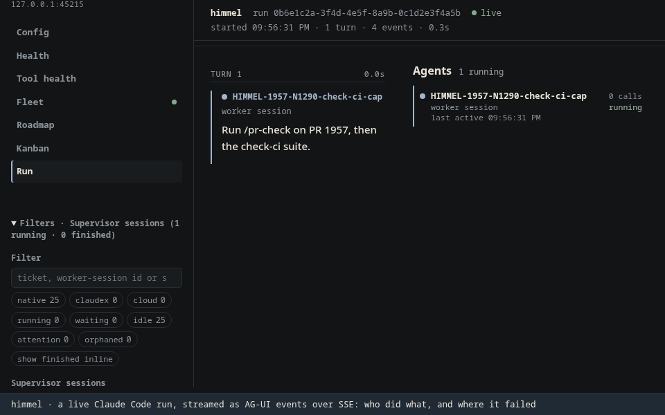

# config-ui

`himmelctl ui` serves the config UI on `127.0.0.1` (Bun, loopback only,
per-launch token). Operator-only: it refuses to start inside a Claude session.

## The config feed

The Config page reads `GET /api/feed`: one `himmelctl report --json` shared by
every request (about two minutes on the station, most of it the doctor).

- **Progress.** The report runs under `probe-progress.cjs` (`node --require`),
  which writes one stderr line per source as it starts:
  `himmel-probe {"i":2,"n":8,"source":"doctor checks"}` (install items, doctor
  checks, each cadence, plugin profile, then lanes, initiative steps, flags and
  secrets). The steps are inferred from the report's spawns, in its fixed order.
  While it runs, a `202` carries `progress` and answers as soon as the step
  changes, and the page shows `probing <source> (i of N)` over a progress bar.
- **Background loading.** `himmelctl ui` starts the report at launch, so it is
  ready by the time you go from Fleet to Config. While the console is in use
  (any authenticated request in the last 10 minutes) the server refreshes it
  every 10 minutes; once you close it, nothing runs and the server still idles
  out. The page asks again when you come back to Config or the tab becomes
  visible, never on a timer.
- **Stale while revalidate.** Once one report has landed, `/api/feed` answers
  the newest one at once and refreshes it behind the scenes after 30 s. An
  action drops it: the next feed waits for a report started after the action.

## Health page (`#/health`)

Read-only: every value is rendered from its owner and nothing is re-measured.
`GET /api/health` (token-gated, GET only) runs three sources in parallel; each
answers `ok`, `absent` or `error` on its own, so one missing source never blanks
the page.

| Section | Source | `No data` means |
|---|---|---|
| Is himmel healthy? | the doctor feed's fail/warn rows plus firing Prometheus alerts | feed still running → `No data`; no Prometheus → `alerts not checked` and `monitoring tier not running` (it never raises the verdict) |
| What is broken · Every item checked | two tabs: feed rows with health `fail` or `warn`, worst first, plus firing alerts, each with ONE fix action (below); and all rows grouped by bundle with a result each, a bundle with a problem open | feed still running |
| Scheduled jobs | feed rows with `source: cadence` | no cadence rows declared |
| Usage | the newest row with usage numbers in the last 64 KiB of `$CADENCE_USAGE_LEDGER` (default `~/.himmel/cadence-ledger.jsonl`), never a fresh `bank-preflight`; the worker list moved to Fleet and Usage links to it | no ledger row with usage numbers |
| Search and graph freshness | feed rows with `bundle: search` (doctor owns qmd freshness) | doctor reports no search rows |

**Project picker and Shared (HIMMEL-8044).** The rail carries a picker: the project this UI runs in
(the page opens on it), the other registered projects (`~/.claude/handover/registry.json`, `repos{name:{path}}`),
and **All my projects** (`#/health?view=all`). Every feed row carries a `scope` (`shared` for the machine or
himmel itself, `project` for the rest) and a `fix.by`, classified once in `config-feed.js` `classifyRow`:
`configure` (a setting a Configure tile writes, `fix.tile` names it: **Open in Configure**), `operator` (only
you can run it: **Copy command**) or `chief` (**chief is on it**, no button). The all-projects view shows the
Shared rows once, never counted in a project's own verdict, then each project worst first. `GET /api/projects`
answers each project from its own cached feed (`~/.himmel/state/config-ui/feeds/<name>.json`, written by the UI
that ran in it) or `not checked`; it never runs a doctor. `GET /api/feed?project=<name>` answers one of them
(404 `not-checked` otherwise). A project's data is only as fresh as its own last UI run.

The **Trends** section (HIMMEL-6969) is fed by `GET /api/rollup` (token-gated, GET
only), which reads `~/.himmel/state/rollup/weekly.jsonl` (`$WEEKLY_ROLLUP_FILE`
overrides) as written by `scripts/eval/weekly-rollup.py` and returns
`{state: ok, cards: [velocity, cost, health]}` (each with the by-week sparkline, the
stored week and version deltas and one sentence) or `{state: absent, reason}` when the
file is missing. The deltas are the writer's; nothing is recomputed. The Fleet page's
Trends tab shows the same cards.

The **How good are our reviewers?** section (HIMMEL-7385) is fed by `GET /api/reviewers` (token-gated, GET
only), which returns `{state: ok, text, writtenAt}` from `~/.himmel/state/review-page/review-page.md`
(`REVIEW_PAGE_FILE` overrides) as rendered by `scripts/eval/review-page.py` (the weekly
`judge-accuracy-cadence.sh` writes it) or `{state: absent, reason}` when the file is missing. The browser
shapes the Markdown: `##` and `###` headings become small headings, the H1 is dropped, `- ` lines become
list items, other lines become paragraphs, and a "Written <date>" footer is added.

The **Usage windows** card (HIMMEL-5486) is fed by `GET /api/bank` (token-gated,
GET only), which reads the two caches `bank-preflight` reads and never spawns a
probe: the Claude usage cache (`$CADENCE_USAGE_CACHE`, else `$CLAUDE_USAGE_CACHE`,
default `/tmp/claude/statusline-usage-cache.json`, stale after
`$CADENCE_USAGE_MAX_AGE`, default 600 s) and the Codex usage cache
(`$CODEX_USAGE_CACHE`, default `~/.himmel/cache/codex-bank.json`, stale after
`$CODEX_USAGE_CACHE_TTL_SECONDS`, default 6 h). Per usage source and window it returns
`{used_pct|null, resets_at|null, captured_at, age_s, state: ok|stale|unknown,
possibly_reset, reason}`. A missing or unreadable cache, or a window the plan
does not report (Codex 5h is often null), is `unknown (why)`, never 0 %; a
`resets_at` already in the past reads `possibly reset`.

Verdict: any `fail` row or a firing `severity="page"` alert → **Act now**; any
`warn` row or any firing alert → **Needs a look**; else **All clear**.
Monitoring URLs are loopback-only (`HIMMEL_PROMETHEUS_URL`, default
`http://127.0.0.1:9090`; flow exporter port `HIMMEL_FLOW_EXPORTER_PORT`, default
9877); a non-loopback URL is refused.

## Tool health page (`#/toolhealth`)

`GET /api/tool-health` is token-gated and GET-only. It reads the registered
`eval-runs` and `worker-failures` ledgers: the server, not the browser, rolls up
calls, failures, error rates and count-weighted known recovery outcomes.
Filter by model, launch lane, worker-vs-chief role and 7/30 UTC calendar days.
The tool table includes daily trends, top failure classes and links to the
session view with tool-call ids. Deny-hook rates use Bash calls as their
explicit denominator. The comparison table shows calls per 100 calls,
error/denial/recovery rates per lane and deltas relative to native.
A "Tools by launch profile" table lists, per profile, each tool's calls,
failure rate, listing cost and a keep or move-to-on-demand suggestion
(`docs/tool-adoption/per-profile-tool-evals.md`). Listing cost is an unbilled
estimate computed in the route: the installed plugin skills (characters over 4)
summed over each profile's enabled plugins, cached in memory for ten minutes,
never a `claude` run. It covers the Skill listing only; MCP tool schemas read
"not measured" and are never suggested for removal. `HIMMEL_PROFILE_LISTING`
(`{profile: {tool: tokens}}`) overrides it for tests. Sessions with no launch
record read as unknown.

No ledger means **No data**. Old digest rows without per-tool counts show
**—**, not 0 %, including summaries that mix old and new rows. Partial or
inconclusive digests also lack complete call denominators. Unknown
recovery outcomes are excluded; trend gaps have no denominator. Day-level
cohorts cannot certify an intraday shift cutoff, so those denominators stay
unknown. Lane comes only from launch metadata, never from a model name;
a document fallback reads the assigned worker's title, not sibling mentions. Ledger overrides:
`HIMMEL_EVAL_RUNS_LEDGER`, `HIMMEL_WORKER_SESSION_FAILURES_LEDGER`.

## Shift page (`#/shift`)

First in the rail, with a badge counting the rows that wait on you. A shift is the whole fleet between cuts, never one
chief's run: every bucket (the voice chief too) counts. `GET /api/shift` (token-gated, GET only; `?id=<opened>` picks a
closed shift) polls `shift.ts`, which is the one writer of `shifts.jsonl` (`$HANDOVER_DIR/shifts.jsonl`, or `SHIFTS_FILE`),
under a lock and idempotent on the shift id. The page shows Chiefs (span and PR credit), Waiting on you (links out; nothing
here acts), Running now and Shipped, and for a closed shift the pager and Carried to the next shift. With no shift open it
says so and names the last one.

- **The cut rule.** A shift closes at the last queue-lock release once nothing was held for 60 minutes, or at the 08:00 and
  20:00 clock cuts once it is at least 4 hours old. It is named day when it opened between 08:00 and 20:00, else night. Stamps
  are ISO 8601 with the offset in force when the shift opened; the window is half open, `[opened, closed)`, so a PR merged at
  the close instant belongs to the next shift. The id is the opened stamp. A clock cut opens the next shift only if something
  was held at the cut; an idle fleet leaves none open until a chief goes live.
- **Merged PRs.** `gh pr list --search merged:<opened>..<closed> --limit 200` (the board's 60 was too few: 49 PRs merged in one
  real night). `GH_CMD` overrides `gh`. A page that comes back full is split by time until every PR is read. A failed `gh` read
  closes nothing: the close waits for the next poll that can read it, so a shift is never written without its PR credit, and the
  page says the list could not be read instead of showing an empty Shipped. A poll older than the last one applied is ignored.
  A chief counts as live only while its own doc holds a queue lock.
- **Attribution.** A PR is credited to the chief whose span holds its merge; a merge in a hand-over gap is named for both and
  counted once. A chief's span is its first LIVE to its last WRAPPED or HALTED stamp.
- **The release record is derived.** `queue-lock` keeps no release record, so the last release is the newest lock heartbeat or
  WRAPPED stamp seen (`ponytail:` in `shift.ts`).

## Roadmap page (`#/roadmap`)

The Roadmap page sits next to Fleet. `GET /api/roadmap` (token-gated, GET only) reads its sources live on every
request: no static render, no republish. The page draws release panels, the drift counts and trend, the worker to Jira
sync plan and the librarian's lists. Clicking a version opens `#/roadmap/<version>`, that version's kanban (filter by
Sector); the left-rail Kanban page (`#/kanban`) shows one board across all versions with no version filter, Done
hideable. Both read the same `/api/roadmap`; an absent mirror shows its reason instead of a board.

The Workflow page (`#/workflow`) draws the development graph: it mounts the docs page's own `dev-graph.js` on its
`graph.json`, which the server hands out read-only under `/dev-graph/` (not token-gated, like `/agui/`; the files
are `docs/guide/dev-graph/`'s `.json`, `.js` and `.css` only). A walkthrough step rides the fragment beside the
route, `#/workflow&w=<id>&s=<n>`.

- **Sources.** The Jira mirror (`HIMMEL_JIRA_MIRROR`, else `~/.himmel/state/jira-mirror/<JIRA_PROJECT_KEY or HIMMEL>`)
  plus its `<mirror>.versions.tsv` snapshot; the plan dir (`HIMMEL_ROADMAP_PLAN_DIR`: `stage1/C??.tsv`,
  `stage1/themes-overlay.tsv`, `stage3/placement.tsv`; without it the board still renders and drift is 0); the drift
  log (`HIMMEL_ROADMAP_DRIFT_LOG`, else `$TRACKER_HANDOVERS_DIR/roadmap-drift.tsv`; read only, `tracker.py` is its
  writer); the workers from `workers.sh`. No mirror: the page says so and names `node scripts/jira/dist/index.js mirror`.
- **tracker.py** stays the CLI/offline renderer until the page reaches parity; the semantics here are a port of it.
- **Sync plan.** `legSync` lists the Jira CLI commands that mirror each worker marker onto its ticket (flag and comment
  a stuck worker, clear the flag on resume, note READY/WRAPPED once). The chief kit is the one writer; workers never
  write Jira and the sync plan never does; only the Kanban writes below change Jira from this page.
- **Writes (HIMMEL-5491).** The Kanban boards are writable: dragging a card to another column transitions the ticket in
  Jira, and the per-card Sector select sets its Sector with `jira edit <key> --sector` (the CLI checks the name against
  the live option list and has no way to clear one, so "no sector" is not offered as a write). Both go through
  `POST /api/roadmap/write` (token gate, same-origin and JSON checks, the machine write lock, one audit row per write),
  body `{key, status}` or `{key, sector}`. The server validates `key` (`HIMMEL-<n>`), `status` (a board column id) and the
  Sector name before any child runs, shells to the Jira CLI (`CONFIG_UI_JIRA_CLI` overrides the CLI path, tests use a stub), then runs an
  incremental `jira mirror` so the board re-reads Jira; the reply says `mirror: refreshed|stale`. A refusal moves the
  card back and shows the reason above the board.
- **Sector grouping (HIMMEL-8379).** A ticket groups under the mirror's `sector:` line; a retired `theme-<slug>` label is the
  fallback, then the plan overlay; a ticket with none is under "(no sector)". The wire keys (`themes`, `theme`, `unthemed`)
  keep their names, the page shows Sector.
- **Librarian.** Stale In Progress, version drift, no sector (it proposes `jira edit <key> --sector`), released-but-open and duplicate titles, as proposals
  only. A fixVersion move or a close needs operator approval or a recorded standing rule. Lane: Opus judgement,
  bulk passes on Haiku. Cadence: event-driven on MERGED/WRAPPED plus a daily sweep.

## Agent run view (AG-UI)

`agui-web/` is a React page that renders an agent run streamed as AG-UI events:
assistant text, tool-call cards, a run strip of parallel calls over time, and
the review panel driven by `STATE_SNAPSHOT` / `STATE_DELTA`. It reads
`/api/agui/<run>` (one constant, `AGUI_URL` in `agui-web/src/stream.ts`) with
the session token from `#t=<token>&run=<id>`; with no `run` it replays the
recorded fixture `agui-web/src/fixture.json`, so it previews without a server.

**Who did what, and where it failed**. Every text and call
belongs to an agent: the session's own (named by its `agent-name` record: a
`-chief`, a worker's `-N<digits>-`, a judge) or a subagent (named by the Agent
call that spawned it: its description, `subagent_type` and model). Each agent
has a colour, a band in the run strip, and a row in the **Agents** list that
shows its role, model, call count and failure count; click a row to show only
that agent. The transcript runs in turns, and one agent's consecutive work sits
under its name, a subagent's one step in. Failures are marked by kind: `error`
and `suite failed` (a test run that exited non-zero) in red, `denied` (a hook or
permission refusal) and `blocked` (a BLOCKED report, by message or in text) in
amber. The top bar counts them, and ↑ / ↓ next jumps to each in turn. Long tool
output shows its first 12 lines with a control for the rest.

```bash
cd scripts/config-ui/agui-web
bun install
bun run build   # → agui-web/dist/ (untracked)
```

`GET /api/agui/<run>` (token-gated, GET only, `agui/sse.ts`) serves that
stream. `resolveJournal(home, run)` finds the file: `<run>` must be a
lowercase session UUID (else `400`), and it must name exactly one
`<root>/projects/<slug>/<run>.jsonl` across the journal roots below (none
`404`; more than one `409`, even when the copies sit in different roots; one
real file reached through two roots counts once). The
journal's real path must stay under the real path of its root's `projects`
directory; a symlinked file or project directory that leaves it does not count.
The response is `text/event-stream`, one
`data: <json>` frame per AG-UI event (the `@ag-ui/encoder` wire format,
hand-encoded: config-ui takes no dependency for it). It maps the file from the
start, then polls for appends every 500 ms, and ends when the client goes away,
2 minutes after the file stops growing with no run open, or after 4 hours. A
`: keepalive` comment every 15 s holds a quiet stream past Bun's idle cut. It
also follows the session's subagent transcripts
(`<run>/subagents/agent-<id>.jsonl` beside the journal, at most 64, each one's
real path inside the journal's directory) and merges their lines with the
journal's in timestamp order. Payload fields (deltas, results, errors, state)
pass the same redactor as the feed; the id fields are left intact, and so are
`agent` (who acted: a session name is often 32+ characters, which the redactor
would blank) and `failure` (one of four words).

**Journal roots.** A session launched with its own `CLAUDE_CONFIG_DIR` opens
in the run view once a live Fleet census poll has seen it; before that, and after a
server restart, its run is `404`. A journal root is a Claude config directory
whose `projects/` holds session journals. `resolveJournal` searches two
built-in roots, `~/.claude` (native) and `~/.claude-codex` (claudex, the lane
that runs Claude Code on Codex models), then every custom root registered so
far.

- **Where custom roots come from.** Only the live census: `readFleet`
  (`agui/fleet.ts`, behind `GET /api/agui/fleet`) reads each live session's
  launch environment from `/proc/<pid>/environ` and, when it carries
  `CLAUDE_CONFIG_DIR`, passes that directory to `registerConfigRoot`
  (`agui/sse.ts`). No request parameter names a root; `/api/agui/<run>` takes
  only the session id.
- **What `registerConfigRoot` refuses.** A path that is relative, contains a
  `..` segment or is not already normalized; a directory with no `projects/`
  directory; and one whose `projects/` resolves outside the config directory's
  real path (a `projects` symlink out of the root). A refused root is never
  searched.
- **How long a root stays.** The registry lives in the server's memory, holds at
  most 32 roots and drops the oldest past that; registering a root again does
  not refresh its place. A custom root is therefore searched only after a fleet
  poll has seen a live session launched with it, until the server restarts or
  the root is dropped.
- **Built-in versus custom.** `resolveJournal` re-checks a custom root on every
  lookup: its `projects/` must still resolve inside the config directory, or
  the root is skipped. The built-in roots skip that check, so a symlinked
  `~/.claude/projects` still works.

For example, a worker launched with `CLAUDE_CONFIG_DIR=/srv/claude-b` and a
`/srv/claude-b/sessions/<pid>.json` naming session `<id>`: the fleet poll
registers `/srv/claude-b` and reads that file for `<id>`, then
`resolveJournal` searches `~/.claude/projects`, `~/.claude-codex/projects` and
`/srv/claude-b/projects` and serves `/srv/claude-b/projects/<slug>/<id>.jsonl`.
Had `/srv/claude-b/projects` been a symlink to `/data/projects`,
`registerConfigRoot` would have refused the root and its journal would not be
found (`404`, unless a built-in root holds the same run).

`GET /agui/` serves the built page from `agui-web/dist` (`/agui` redirects
there) with the same CSP and frame headers as every other page. It serves only
regular files whose real path stays inside `dist`, so traversal, a symlink out
and a directory are `404`; when `dist` is not built it answers `404` with the
build steps. The page itself is not token-gated (the token rides the URL
fragment, never a request line); `/api/agui/<run>` stays gated.

### Watching a live run (operator steps)

From your own terminal, outside Claude, in the himmel checkout:

```bash
# 1. build the page once (and again after agui-web/src changes)
cd scripts/config-ui/agui-web
bun install
bun run build
cd ../../..

# 2. start config-ui and print the AG-UI URL for the newest session
node scripts/himmelctl/bin.js ui --port 0 --agui latest
```

It prints one URL, `http://127.0.0.1:<port>/agui/#t=<64 hex>&run=<session-id>`.
`--agui latest` picks the newest `~/.claude/projects/*/<id>.jsonl` by
modification time; `--agui <session-id>` picks one session. The server runs in
the foreground (Ctrl-C to stop); an open stream keeps it from idling out.

**Fleet view.** `--agui` with no session id prints the fleet URL,
`http://127.0.0.1:<port>/agui/#t=<64 hex>` (the token, no `run`): one row per
live Claude session (chief, worker, judge or interactive) with its ticket and PR,
state (running, idle, waiting for GO, wrapped), latest tool call and its age,
subagent counts and failure count. Wrapped workers sit in a closed section, never
in the live list. Clicking a row's name opens that session's run page. The page polls
`GET /api/agui/fleet` (token-gated, GET only, read-only, `agui/fleet.ts`),
whose census is `fleet.sh`: `claude_sessions` plus each worker doc's last marker
(`worker_tail_status`). A session whose journal has been quiet for an hour is left
out.

**Cloud sessions.** A `claude --cloud` session has no local
process, so its node comes from the chief buckets' `cloud-route.jsonl` (each
ticket's newest routing across them; a CLOUD-OK from the last 72 hours) plus its
PR on GitHub: the newest PR whose title cites the ticket, and the `CLOUD-DONE` /
`CLOUD-BLOCKED` comment carrying the session link. It hangs under the chief
its brief names, and a local worker on the same ticket (its shepherd) hangs under
it. Its tokens read "not measured": no source exposes a cloud session's usage.
GitHub is read in one batched GraphQL query per minute at most
(`agui/fleet-cloud.ts`, shared and cached); a failed or throttled read, or one
still running after 2 seconds, shows the nodes as "GitHub status unknown" for
that poll and never holds up the page longer.

**Sections, orphans and filters.** Empty attention lists are hidden:

- **Needs you** lists operator-owned `CLOUD-BLOCKED` questions on a PR.
- **Needs the chief** lists chief actions, by severity:
  - a `BLOCKED` or `FINDING` marker;
  - context at 85 % or more of the session's real window (the launch's declared
    `CLAUDE_CODE_MAX_CONTEXT_TOKENS`, then `--autocompact`, then the model's);
  - a `CLOUD-DONE` PR awaiting its shepherd.
  The chief board's action cards also appear here. Each session's highest-severity
  attention reason has one owner, defined in `fleet-model.ts`; the attention count
  and state filter cover both lists. Permission prompts and MCP-auth waits need
  structured row signals before they can be assigned to the operator.
- **Orphans** lists live sessions no live chief watches, with the reason and
  "adopt via relay / close". It also lists the shell-tool wrappers the chief
  tick reports, read from the chief kit's `orphan-loops.sh --list`, with pid,
  owner, age and how to close each. The page never signals a process.
- **Running** groups sessions per live chief.
- **Finished** is closed by default.

Cloud is a lane like native and claudex. A cloud session is never an orphan for
want of a shepherd.

Each card is one line: its name links to the run page (a cloud session's to its
cloud session) and its chevron expands the status and lineage detail. A worker's
hops (`N1494`, `N1494b`, `-RESUME`) and a chief's succession chain each fold
into one entry, with every hop linked.

The rail's filters (lane, state, text, finished inline) narrow every section.
They are kept per viewer in the browser.

A finished row links its PR to this checkout's GitHub origin
(`CONFIG_UI_GITHUB_REPO=<owner>/<name>` overrides it).

**One app.** The console and the AG-UI pages share one rail and one
theme (`public/nav.js`, `public/theme.css`): Config, Health and Fleet, plus Run
on a run page. Plain `himmelctl ui` prints ONE URL and lands on the fleet when
`agui-web/dist` is built, on the console when it is not; `LANDING` in
`server.ts` is the one-line switch (`"config"` lands on the console). The token
only ever travels in the URL fragment: the console reads `#t=<token>[&page=<id>]`
and clears it from the address bar, the AG-UI page keeps `#t=<token>`, and
requests carry it in the `X-Himmel-Token` header. The rail's Fleet dot is the
census health (ok, degraded = warn, unavailable or unreachable = fail, not yet
read = off), in the status colours; on the console it is read on load and on
each page change, never polled, so an open console still idles out. A worker's
fleet row also links to the Health page (its workers and usage cards).

**Service mode.** `server.ts --service` (what `himmelctl ui --service install` runs under
systemd) takes its token from `~/.himmel/state/ui-token` (`token-file.ts`: created once,
a symlink or a file that is not mode 600 is refused), never idles out, and rebuilds
`agui-web/dist` at start when it is missing or older than its sources. The board route serves
`<chief doc>.board.json` (re-read when its mtime moves) before falling back to running
`board.mjs`. Tests: `tests/service-mode.test.ts` (real server), `tests/service-verb.test.ts`
(the verb against a stub `systemctl`).

**Login.** `/login` takes one operator user and password. Set them from your own terminal with
`bun scripts/config-ui/server.ts --set-login <user>`, which reads the password from stdin: echo is off
and it asks twice on a terminal, the minimum is 8 characters. The login is stored in the OS keyring as the item
`HIMMEL_UI_LOGIN` (through `scripts/lib/himmel-secrets`, so it needs an unlocked Secret Service), as a scrypt hash,
never the password. The process env never overrides it, and a locked keyring, or a keyring lookup that fails, answers
500, not 404. macOS has no resolver keyring backend, so `--set-login` fails there and the UI is token-only on macOS. A login file
from before the keyring, `~/.himmel/state/ui-login`, is read once with a deprecation notice, moved into the keyring
and removed; a symlink or a file others can read is refused.
`POST /api/login` (same-origin JSON) answers with an `HttpOnly; SameSite=Strict` session cookie that lasts one
hour. Sessions live in memory, so a restart logs you out. After five failed logins in 15 minutes every login
gets 429 with `Retry-After`, even one with the right password. The limit is global because every client
reaches the loopback server from the same address. `POST /api/logout` ends the session. `/api/*` accepts
either the session or the launch token. The token stays for automation and for the printed URL, but in
service mode only a session may save a secret on the Configure page. Tests: `tests/login.test.ts`,
`tests/setup-account.test.ts`, both against a stub `secret-tool` (`tests/keyring-stub.ts`), never the real keyring.



*A live stream over the real SSE path, not a mock: a fixture session journal and
its subagent's transcript are appended to while the page is open, and the page
renders each event as the server pushes it.* Regenerate it from your own terminal (needs `ffmpeg`, the
built `agui-web/dist`, and Playwright's Chromium build 1243):

```bash
bash scripts/config-ui/tests/e2e/record-agui-gif.sh
```

The view logic is a pure reducer (`agui-web/src/reducer.ts`) with no runtime
imports, so its suite runs in CI without an install.

## Tests

- Unit and server suites: `bun test scripts/config-ui --dots` (CI-gated).
  `probe-progress.test.ts` drives the preload with a fake report;
  `feed-background.test.ts` covers the progress `202`, the launch prewarm, the
  in-use refresh and stale-while-revalidate.
- Toggles end to end (`toggles.test.ts`, CI-gated, skipped on
  Windows): every console toggle through the real `himmelctl` and the real
  server routes (preview, run), checking that the setting is written, that its
  owner reads it back, and that the run's re-probe and a fresh feed show it,
  then the opposite flip. It runs against a temp `HOME` and a temp repo of
  symlinks, with fake `crontab`, `claude`, `qmd` and `graphify` and a stub
  doctor, so the checkout's `.env`, `lanes.local.json`, crontab and plugins are
  never touched. CI flips one plugin and one lane (same argv for each);
  `CONFIG_UI_TOGGLES_ALL=1` flips every one. Results:

  | Toggle | Works end to end? |
  |---|---|
  | cadence arm/disarm (pipeline, qmd, graphmap, doctor) | yes: a crontab entry, `status` reads `ARMED` / `not armed`, the row flips |
  | initiative on/off (execute, prcheck, pr, ticket, handover) | yes: `HIMMEL_INITIATIVE` in `~/.himmel/himmel.conf`, `config get` and the SessionStart hook agree, the row flips |
  | plugin enable/disable (on-demand tier) | yes: user scope flips, `plugin-profile.sh list` agrees, the row flips |
  | lane on/off | written and read back (`probe.kind` always / never), but **the row cannot show which**: it reads `local override in lanes.local.json` for both (config-feed.js `laneRows`) |

  `profile.set` is in the action table, but no feed row offers it, so it is not
  a console toggle. Served from a git **worktree**, the server runs `config set`
  with `HIMMELCTL_REPO_ROOT` set to the primary checkout (the feed's station
  anchor), so initiative and lane toggles write the `.env` and `lanes.local.json`
  the feed and the live hooks read. An operator-set `HIMMELCTL_REPO_ROOT` wins.
- Browser e2e: `scripts/config-ui/tests/e2e/`, Playwright pinned
  to 1.64.0. **Opt-in, not in CI**: a runner has no
  cached Chromium, and fetching one on every PR would make a download outage
  red-flake the fleet. Provision the matching browser in a VM first (operator
  step), then run it where `~/.cache/ms-playwright` already holds that build:

  ```bash
  cd scripts/config-ui/tests/e2e
  bun install
  bunx playwright test
  ```

  Each test boots its own real `himmelctl ui --port 0` against a fixture feed
  (stub via `CONFIG_UI_HIMMELCTL`; the live station feed never runs). The
  bundle order comes from `scripts/himmelctl/lib/feed-bundles.json`.
  `E2E_BREAK=order` feeds a mis-ordered bundle list: the suite must go red.
  It also covers the probe progress bar (a held report writes four steps) and
  background loading (Fleet first, then Config in a new tab: the report is
  already there).
- AG-UI page e2e (`agui.e2e.ts`, same opt-in suite): needs
  `agui-web/dist` built (see above; the tests skip when it is absent). Each
  test boots `himmelctl ui --agui` against a temp `HOME` and appends journal
  lines while the page is open, asserting the live render, the wrong-token
  error state, and both themes at desktop and phone width. A further case adds
  a worker with a critic subagent (`SCENE` in `agui-fixtures.ts`, also the GIF's
  run): agent attribution and the filter, failure marking and the jump
  control, and the long-output control. Another adds the fleet landing
  over a fixture fleet (`agui-fleet-fixture.ts`: 3 live sessions and 1
  wrapped) and the click through to a run. Another adds the walk console to
  Fleet to a run and back over the shared rail, and checks no request line
  carries the token.
- Docs link and tokens e2e (`docs-link.e2e.ts`, same opt-in suite): the rail
  ends with a Docs link to the public site in a new tab with
  `rel="noopener noreferrer"` and no session token, and the console reads the
  shared tokens (`public/tokens.css`) in light and dark with system fonts.
- Tracker sources e2e (`tracker-sources.e2e.ts`, same opt-in suite): `boot()`
  takes a `tracker` option (`jira` seeds a one-ticket mirror and is the
  default, `github` a stub `gh` answering fake issues, `local` and `none` neither).
  The rail lists Roadmap and Kanban only for `jira` and `github`; with `none` a
  direct landing on Kanban shows the plain-words empty state, and with `github`
  the cards are read-only. `GET /api/sources` (`tracker-sources.ts`) is the one
  predicate behind it.
- Configure e2e (`settings.e2e.ts`, journey J3, same opt-in suite): Configure is
  the one rail entry (it replaced Settings and Setup; `#/setup` and the install
  hand-off's `page=setup` land on it with the Secrets tile open) with four tiles
  in order, one open at a time, and the Check this install strip under them (hidden while a tile is open).
  Every Project scope row shows its command, when it takes effect and a Learn
  more link to the docs site, the Tracker tile points commit rules at
  `~/.himmel/himmel.conf`, a switch previews its dry-run first, and Roadmap and
  Kanban follow the tracker source. Triage and the inventory render on Health.
- Fleet cap and reviewer settings (`fleet-cap.ts`, `review-gate.ts`; `GET` and `POST
  /api/fleet-cap`, `/api/review-gate`): the cap goes to the station `.env`, a reviewer's
  model and effort to the `critics.local.json` overlay only. Tests:
  `tests/fleet-cap-reviewers.test.ts` (route, write, lock and overlay rows).
- Setup e2e (`setup.e2e.ts`, same opt-in suite): the Configure page is `renderConfigure` in `public/setup.js`,
  its state and secret writes are `setup.ts` (`GET /api/setup`, `POST
  /api/setup/secret`). A runtime-computed canary token is saved and removed
  through the page against the temp-HOME store, and a scan of the markup, fields,
  browser storage, audit log and argv must never find it (a control test plants
  it to prove the scan sees each place). Commit rules preview before they apply.
- Development graph docs page e2e (`dev-graph-docs.e2e.ts`, journey J-DG1,
  same suite): it needs no himmelctl. It serves `docs/guide` over `node:http`
  and walks `dev-graph.html`: node count, the W2 NO-GO step as refused with its
  condition and source, the `#w=&s=` deep link, autoplay, reduced motion (no
  autoplay, no `animate` call, no running animation), no horizontal scroll at
  390 px, dark `--bg`, and the error banner for an unknown id or an unjoined
  step. A spec must be named `*.e2e.ts` to be picked up.
- Workflow page e2e (`dev-graph-ui.e2e.ts`, journey J-DG2, same suite): the rail
  shows Workflow, the page loads `/dev-graph/graph.json` and draws every node,
  W1 steps to its last step with `#/workflow&w=&s=` riding the fragment, a deep
  link restores a step, leaving and coming back does not stack a second graph,
  and the page runs under the server's CSP with zero violations (a planted
  inline style proves the detector fires). `/dev-graph/` serves only the
  `.json`/`.js`/`.css` files of `docs/guide/dev-graph/`: traversal, a path
  outside the directory, the directory itself and a POST are refused.

## Manual pass (the same 7 items)

From your own terminal (not inside Claude):

```bash
node scripts/himmelctl/bin.js ui --port 0
```

Open the printed URL, `http://127.0.0.1:<port>/#t=<64 hex>` (the token rides
the fragment). The printed URL opens Configure; click Health in the rail first, because items 1-7 are about Inventory, which lives there. The first report can take a couple of minutes.

- [ ] 1. Controls and Inventory render as bundles in table order (Search & graph … Install & toolchain).
- [ ] 2. A bundle with no fail or warn row is collapsed; one with a fail or warn row opens by default.
- [ ] 3. Each header shows its headline health plus only the non-zero counts (Bypass flags reads `48 off`).
- [ ] 4. "Show only problems" hides healthy rows; header counts read `n of N`.
- [ ] 5. Searching `C45` opens Search & graph with the hit row; clearing restores the default state.
- [ ] 6. Tab to a header; Enter or Space toggles it; focus stays on that header after the repaint.
- [ ] 7. Unsorted is absent with 0 unmapped rows; when one exists it is always open and last.
- [ ] Header: above the page, one line shows `himmel <version> · <describe>`, the 12-char commit, the served checkout and the feed time; a feed without `himmel` reads `version unknown (feed has no himmel identity)`.
- [ ] Page links: click Configure in the rail first. The rail lists the pages (Configure, Health and Fleet, with the Fleet dot in a status colour), the current one is highlighted, and the address bar reads `#/config` (the token never stays in the URL).
- [ ] Safety: click a toggle: only a dry-run plan appears; confirm stays disabled until you type the target; cancel clears it.
